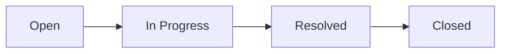
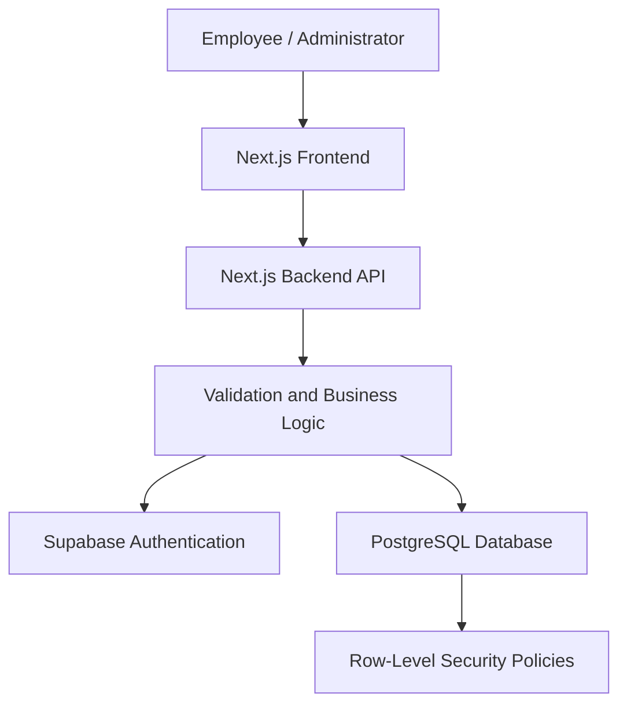
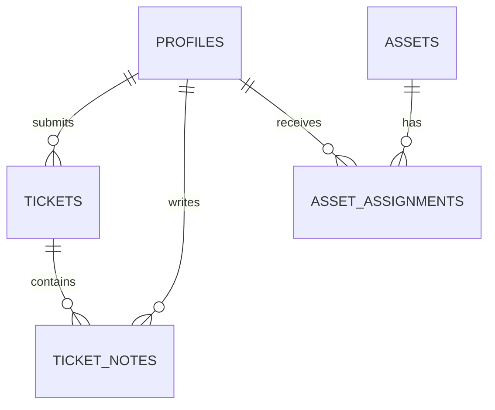

# IT Asset & Support Ticket Management Website


A full-stack web application designed to help organizations manage IT support requests, IT assets, employee accounts and asset assignments through a centralized, secure and user-friendly platform.

Developed independently as a final-semester Capstone project for the Computer Systems Technology – Software Development program at Mohawk College.

## Live Application

**Website:** [IT Asset & Support Ticket Management](https://capstone-asset-ticket-management.vercel.app)

The application is deployed using Vercel and Supabase.

The system supports two user roles: Employee and Administrator. Demonstration credentials are available upon request and are not published in this repository.

## Table of Contents

- [Project Overview](#project-overview)
- [Key Features](#key-features)
- [Technology Stack](#technology-stack)
- [System Architecture](#system-architecture)
- [Project Structure](#project-structure)
- [Database Design](#database-design)
- [Security](#security)
- [Getting Started](#getting-started)
- [Environment Variables](#environment-variables)
- [API Overview](#api-overview)
- [Testing and Quality Assurance](#testing-and-quality-assurance)
- [Development Timeline](#development-timeline)
- [Deployment](#deployment)
- [Future Enhancements](#future-enhancements)
- [Learning Outcomes](#learning-outcomes)
- [Author](#author)

## Project Overview

Organizations often need an efficient way to manage employee IT support requests and maintain accurate records of their technology assets.

This application provides a centralized solution that allows employees to submit and track support tickets while enabling administrators to manage requests, user accounts, IT equipment and asset assignments.

The project focuses on:

- Centralized IT support ticket management.
- Efficient IT asset tracking and inventory management.
- Secure authentication and role-based access control.
- Reliable database operations and data integrity.
- Responsive and accessible user interfaces.
- Automated testing and maintainable application architecture.

## Key Features

### Employee Features

- Secure login and logout.
- View personal profile information.
- Update account password.
- Submit IT support tickets.
- Select ticket categories and priority levels.
- View previously submitted support tickets.
- Track ticket status and update information.
- View personally assigned IT assets.
- Access a responsive employee dashboard.

### Administrator Features

- Access an administrator dashboard.
- Create employee and administrator accounts.
- View and manage submitted support tickets.
- Update ticket statuses.
- Add internal administrator-only ticket notes.
- Delete support tickets.
- Create, view, update and delete IT asset records.
- Assign and unassign assets.
- Track current and historical asset assignments.
- Search support tickets by title.
- Filter tickets by status.
- Sort tickets by submission date.
- Filter assets by assignment status.

### Support Ticket Workflow

Support tickets follow four available statuses:



New tickets are automatically assigned an Open status. Administrators manage subsequent status changes.

Supported ticket categories:

- Hardware Issue
- Software Issue
- Network Issue
- Access Request
- Other

Supported priority levels:

- Low
- Medium
- High

### IT Asset Management

The application supports the following asset categories:

- Desktop Computer
- Laptop
- Monitor
- Keyboard
- Mouse
- Printer
- Software License
- Other

Each asset has a unique system-generated asset code and serial number.

The system prevents multiple active assignments for the same asset and maintains assignment history when assets are returned.

## Technology Stack

| Category | Technologies |
| --- | --- |
| Frontend | Next.js 16, React 19, TypeScript |
| Styling | Tailwind CSS 4 |
| Backend | Next.js API Route Handlers, TypeScript |
| Database | PostgreSQL |
| Authentication | Supabase Auth |
| Authorization | Role-Based Access Control, Row-Level Security |
| Unit Testing | Jest |
| API Testing | Postman / Newman |
| End-to-End Testing | Cypress |
| Accessibility Testing | Google Lighthouse |
| Security Testing | OWASP ZAP |
| Deployment | Vercel |
| Version Control | Git and GitHub |
| Development Environment | Visual Studio Code |

## System Architecture

The project follows a full-stack monorepo architecture with separate frontend and backend applications.



### Frontend

The frontend is responsible for:

- User interface and navigation.
- Responsive layouts.
- Employee and administrator dashboards.
- Forms and user interactions.
- Communication with backend API endpoints.
- Displaying validation, success and error messages.

### Backend

The backend is responsible for:

- Authentication and authorization.
- API request handling.
- Server-side input validation.
- Ticket and asset management operations.
- Database communication.
- Business rules and data integrity.
- Structured error logging.

### Database

Supabase provides PostgreSQL database services, authentication and Row-Level Security policies.

Database constraints and access policies help protect application data and enforce business rules independently of the frontend.

## Project Structure

```text
Semester-6-Capstone-Project/
│
├── frontend/
│   ├── src/
│   │   ├── app/
│   │   ├── components/
│   │   └── lib/
│   │       └── api/
│   ├── cypress/
│   │   └── e2e/
│   ├── cypress.config.ts
│   └── package.json
│
├── backend/
│   ├── src/
│   │   ├── app/
│   │   │   └── api/
│   │   └── lib/
│   │       ├── assets/
│   │       ├── auth/
│   │       ├── errors/
│   │       ├── supabase/
│   │       ├── tickets/
│   │       └── validation/
│   ├── security/
│   └── package.json
│
├── supabase/
│   └── migrations/
│
├── postman/
│   └── authentication.postman_collection.json
│
├── vercel.json
└── README.md
```

## Database Design

The application uses a relational PostgreSQL database.

### Main Database Tables

| Table | Purpose |
| --- | --- |
| `profiles` | Stores application-specific user information and roles. |
| `tickets` | Stores employee support requests, categories, priorities and statuses. |
| `ticket_notes` | Stores internal notes added by administrators. |
| `assets` | Stores IT asset information and unique identifiers. |
| `asset_assignments` | Tracks current and historical asset assignments. |

Authentication credentials are managed separately through Supabase Auth.

### Entity Relationships



Database migrations are maintained in the `supabase/migrations/` directory.

Database-level rules include:

- Unique asset codes.
- Unique asset serial numbers.
- Valid user roles and ticket statuses.
- Foreign key relationships.
- Prevention of multiple active assignments for an asset.
- Assignment date validation.
- Row-Level Security policies.

## Security

Security was considered throughout the development process.

The application implements:

- Supabase authentication.
- Role-based access control.
- Row-Level Security policies.
- Server-side input validation.
- Password complexity requirements.
- Secure session handling.
- Administrator-only operations.
- Employee-specific data access.
- Restricted access to internal ticket notes.
- Generic user-facing error messages.
- Structured server-side error logging.
- HTTPS in the deployed environment.

Sensitive environment variables and service role keys must never be committed to the repository or exposed to the frontend.

## Getting Started

### Prerequisites

Before running the application locally, ensure that you have:

- Node.js 20.9 or later.
- npm.
- Git.
- A Supabase project.

### 1. Clone the Repository

```bash
git clone https://github.com/dhairya6570/Semester-6-Capstone-Project.git

cd Semester-6-Capstone-Project
```

### 2. Configure Supabase

Create a Supabase project and apply the SQL migration files from the `supabase/migrations/` directory in chronological order.

Configure the authentication environment and create the initial administrator account with a corresponding administrator profile.

### 3. Install Backend Dependencies

```bash
cd backend
npm ci
```

Configure the backend environment variables before starting the application.

### 4. Start the Backend

```bash
npm run dev -- --port 3001
```

Backend URL:

```text
http://localhost:3001
```

### 5. Install Frontend Dependencies

Open a separate terminal from the project root.

```bash
cd frontend
npm ci
```

Configure the frontend environment variables before starting the application.

### 6. Start the Frontend

```bash
npm run dev -- --port 3000
```

Frontend URL:

```text
http://localhost:3000
```

Both development servers must be running when using the application locally.

## Environment Variables

### Backend

Create a `backend/.env.local` file:

```env
SUPABASE_URL=your_supabase_project_url
SUPABASE_PUBLISHABLE_KEY=your_supabase_publishable_key
SUPABASE_SERVICE_ROLE_KEY=your_supabase_service_role_key
```

### Frontend

Create a `frontend/.env.local` file:

```env
NEXT_PUBLIC_API_URL=http://localhost:3001
```

The Supabase service role key is intended for server-side use only.

Do not commit `.env.local` files, real credentials, authentication cookies or private API keys to GitHub.

## API Overview

The backend provides API endpoints for authentication, profile management, support tickets, user administration and IT asset management.

| Endpoint | Purpose |
| --- | --- |
| `/api/health` | Application health check |
| `/api/auth/login` | User authentication |
| `/api/auth/logout` | User logout |
| `/api/auth/session` | Current session information |
| `/api/profile` | User profile information |
| `/api/profile/password` | Password updates |
| `/api/admin/users` | Administrator user management |
| `/api/tickets` | Ticket creation, listing, filtering and sorting |
| `/api/tickets/[id]` | Individual ticket operations |
| `/api/tickets/[id]/notes` | Internal administrator notes |
| `/api/assets` | Asset creation and listing |
| `/api/assets/[id]` | Individual asset operations |
| `/api/assets/[id]/assign` | Asset assignment |
| `/api/assets/[id]/unassign` | Asset unassignment |
| `/api/my/assets` | Employee-assigned assets |

Protected endpoints enforce authentication and role-specific access restrictions.

## Testing and Quality Assurance

Testing was performed throughout the development process, with regression testing used to verify existing functionality as new features were introduced.

### Final Recorded Testing Results

| Testing Tool | Result |
| --- | --- |
| Jest | 15 test suites and 114 tests passed |
| Postman / Newman | 58 assertions passed |
| Cypress | 11 end-to-end tests passed |
| Google Lighthouse | 100/100 accessibility on five audited pages |
| OWASP ZAP | Zero alerts in the targeted security scan |

These results represent recorded project testing sessions rather than continuously updated CI results.

### Unit Testing

Jest was used to test backend validation, authentication rules, ticket queries, asset operations and error handling.

Run the backend unit tests:

```bash
cd backend
npm test
```

### API Testing

Postman was used to test API functionality, authentication, authorization, request validation and error responses.

The Postman collection is available in the `postman/` directory.

Import the collection into Postman and configure the appropriate backend URL and disposable testing credentials.

### End-to-End Testing

Cypress was used to verify application workflows, including:

- Employee support ticket management.
- Administrator ticket management.
- IT asset management.
- Asset assignment and unassignment.
- Ticket filtering, searching and sorting.

Run Cypress from the frontend directory:

```bash
cd frontend
npx cypress open
```

For headless execution:

```bash
npx cypress run
```

Configure the required Cypress test credentials using local environment configuration. Both frontend and backend servers must be running.

Use disposable testing accounts and a dedicated test environment.

### Accessibility Testing

Google Lighthouse was used to evaluate application accessibility.

| Page | Accessibility Score |
| --- | ---: |
| Login | 100/100 |
| Admin Dashboard | 100/100 |
| Manage Tickets | 100/100 |
| Manage Assets | 100/100 |
| Profile | 100/100 |

Additional development checks included responsive layouts, keyboard navigation and text resizing.

Lighthouse scores represent automated accessibility audit results and do not establish complete WCAG conformance.

### Security Testing

OWASP ZAP was used for targeted SQL injection and cross-site scripting testing.

The documented scan completed with 32 HTTP requests and zero security alerts.

The scan was limited to a selected authenticated endpoint and did not establish comprehensive stored-XSS coverage or application-wide security.

Further information is available in the [security testing documentation](backend/security/README.md).

## Development Timeline

The project was developed incrementally over a structured 12-week development period.

| Week | Development Activities |
| --- | --- |
| Week 1 | Project initialization, architecture and database foundation |
| Week 2 | User authentication and role-based access |
| Week 3 | User profile and account management |
| Week 4 | Employee support ticket management |
| Week 5 | Administrator ticket management and initial security testing |
| Week 6 | Application deployment and regression testing |
| Week 7 | IT asset management |
| Week 8 | Asset assignment and unassignment |
| Week 9 | Filtering, searching and sorting |
| Week 10 | Security, error handling and structured logging |
| Week 11 | Accessibility, responsiveness and reliability |
| Week 12 | Final regression testing and application polish |

Feature branches were used throughout development to organize changes, test functionality and maintain a stable main branch.

## Deployment

The application is deployed using Vercel and Supabase.

The root `vercel.json` configuration defines separate frontend and backend services within the deployment.

Requests are routed as follows:

- `/api/*` requests are routed to the backend service.
- Other application requests are routed to the frontend service.

Supabase provides the hosted PostgreSQL database and authentication services.

Environment variables are configured securely within the deployment environment.

## Future Enhancements

Potential future improvements include:

- Email notifications for ticket submissions and status changes.
- File and screenshot attachments for support tickets.
- Advanced reporting and analytics dashboards.
- QR code and barcode scanning for IT assets.
- Additional ticket assignment and escalation workflows.
- Expanded security and automated testing coverage.

These enhancements could make the application more suitable for larger organizations and more complex IT support environments.

## Learning Outcomes

This project provided practical experience in:

- Full-stack web application development.
- REST API design and implementation.
- Relational database design.
- Authentication and authorization.
- Secure application development.
- Automated testing and regression testing.
- Accessibility and responsive web design.
- Cloud deployment and environment configuration.
- Git-based development workflows.
- Independent project planning and management.

Completing this project provided an opportunity to apply the knowledge and skills gained throughout the Software Development program to a complete, practical software application.

## Author

**Dhairya Patel**

Computer Systems Technology – Software Development

Mohawk College, Hamilton, Ontario, Canada

**Course:** COMP 10202 – Capstone

**Semester:** Fall 2026

**Project Type:** Individual Capstone Project

[GitHub Profile](https://github.com/dhairya6570)

---

Developed as part of the final-semester Capstone project at Mohawk College.
